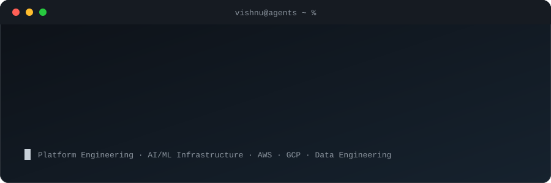
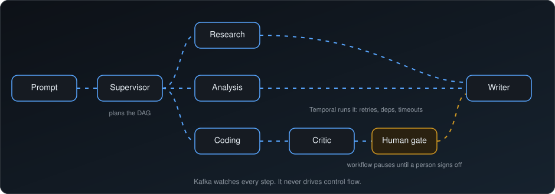

## 👋 Hi, I'm Vishnu

I'm a **Sr. Software Engineer** in Bengaluru working on **platform engineering, AI/ML infrastructure and data engineering** across **AWS and GCP**. On the side I build multi-agent systems.

## 🧠 How I think about agents

Most "multi-agent" demos hardcode who runs when. I split **planning** from **execution**: a Supervisor agent plans the task DAG, and Temporal decides when each step actually runs. Risky steps stop at a human gate.

## 🚀 Featured

### [Multi-Agent Platform](https://github.com/VishnuVV27/Multi-Agent-platform)
Production-grade agent platform: **Temporal**-orchestrated DAGs, human-in-the-loop approvals, **Kafka** observability and a **Next.js** control-plane dashboard.

`Python` `FastAPI` `Temporal` `Kafka` `LiteLLM` `Langfuse` `pgvector`

## 🛠️ Toolbox

**Cloud & platform**

**Languages**

**Backend & data**

## 🤝 Open source

 **[Fix redundant API call in `gh issue view --comments`](https://github.com/cli/cli/pull/12652)**, merged into GitHub's official CLI.

## 📚 Learning

- 🧬 **Generative AI with LLMs** (DeepLearning.AI × AWS): PEFT/LoRA vs full fine-tuning, RLHF, prompt engineering, production deployment
- 🤖 **Agentic AI and MCP**: *Build Your First Agentic AI System*, *Model Context Protocol: Hands-On with Agentic AI*
- ☸️ **Kubernetes**: CKAD prep, with the exam next and then CKA
- 🐳 **Docker Foundations** and ☕ **Java Foundations** (JetBrains) professional certificates

**Following:** [vLLM](https://github.com/vllm-project/vllm) · [CrewAI](https://github.com/crewAIInc/crewAI) · [langchaingo](https://github.com/tmc/langchaingo) · [Flyte](https://github.com/flyteorg/flyte) · [GitHub CLI](https://github.com/cli/cli)
